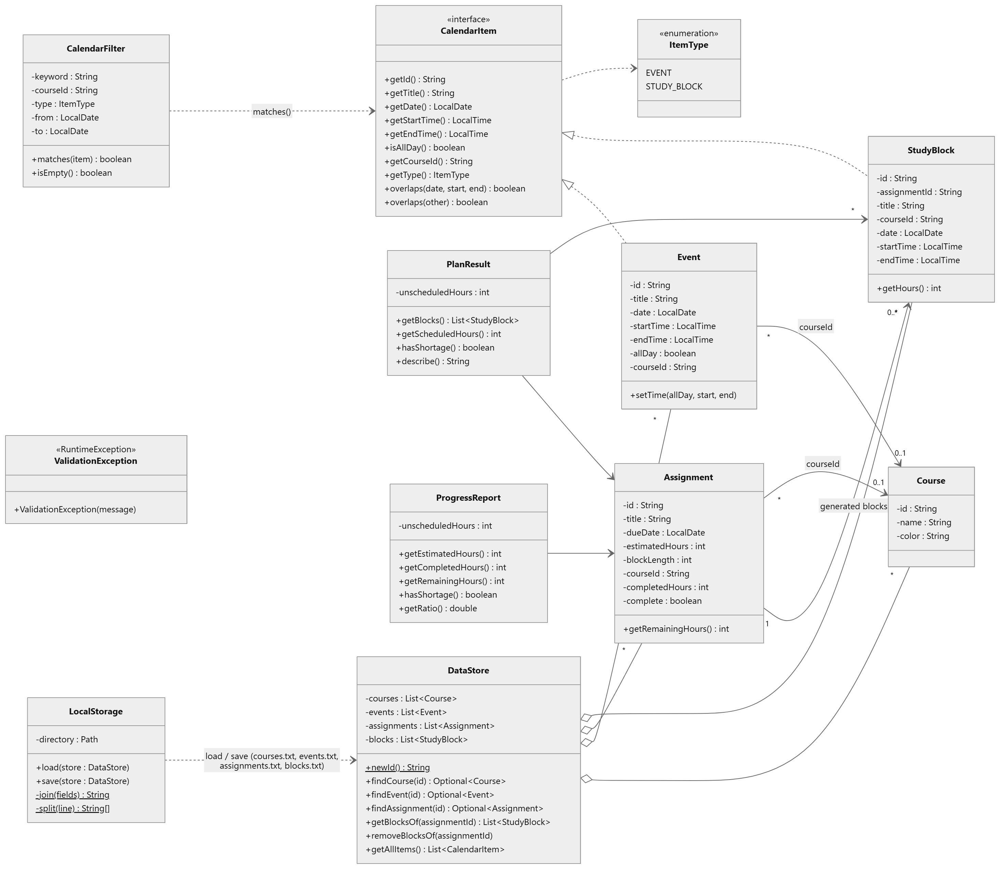
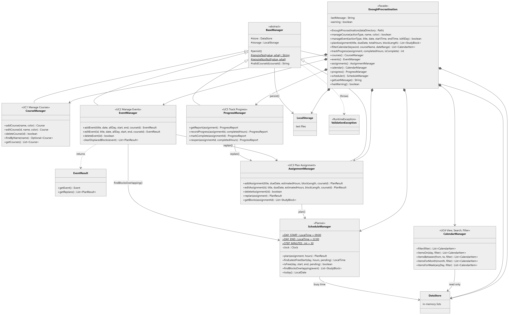
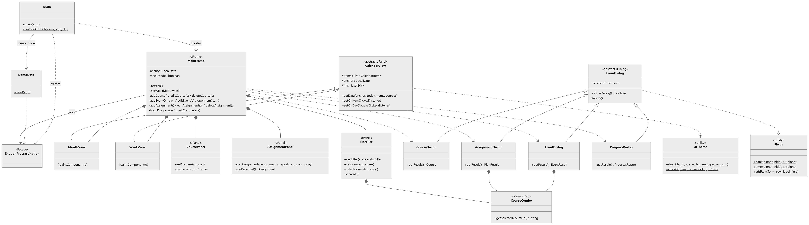

# Enough Procrastination — Class Diagrams (CP3)

Jisu Han (233950)

Sources: [`class-diagram.puml`](class-diagram.puml) (PlantUML, two diagrams) and
[`class-diagram.html`](class-diagram.html) (Mermaid, three diagrams; open in a browser to re-render).
Rendered images are in `docs/diagrams/`.

| Figure | Image | Packages |
|---|---|---|
| 1. Domain model and local storage | `diagrams/class-diagram-1-model-storage.png` | `ep.model`, `ep.storage` |
| 2. Service layer and API facade | `diagrams/class-diagram-2-service-api.png` | `ep.service`, `ep.api` |
| 3. GUI and entry point | `diagrams/class-diagram-3-gui.png` | `ep.ui`, `ep` |

## Mapping the diagram to the functionality

The architecture follows the sequence diagrams of CP2: the GUI talks to one *manager* per use case,
managers validate input and change the shared `DataStore`, and `LocalStorage` persists the store to
files after every successful change.

| Requirement / use case | Classes in the diagram | How they work together |
|---|---|---|
| **UC1 Manage Courses** — add / edit / delete; name not blank or repeated; delete only clears links | `CourseManager`, `Course`, `CourseDialog`, `CoursePanel` | `CourseDialog` calls `CourseManager.addCourse / editCourse`; `checkUnique` enforces the rules; `deleteCourse` nulls `courseId` on `Event`, `Assignment`, `StudyBlock`. |
| **UC2 Manage Events** — timed or all-day; end after start; event beats study block | `EventManager`, `EventManager.EventResult`, `Event`, `EventDialog` | `EventManager.validate` rejects bad times. After saving, `ScheduleManager.findBlocksOverlapping` finds displaced blocks and `AssignmentManager.replan` rebuilds those assignments; the result list is returned in `EventResult`. |
| **UC3 Plan an Assignment from a Deadline** — split hours into blocks, search backward, skip taken slots, warn on shortage | `AssignmentManager`, `ScheduleManager`, `Assignment`, `StudyBlock`, `PlanResult`, `AssignmentDialog` | `AssignmentManager.addAssignment` validates, then `replan` → `ScheduleManager.plan` which walks days from due-1 back to today and slots from 22:00 down to 09:00 using `isFree`. Unplaced hours come back in `PlanResult.getUnscheduledHours()` and the GUI shows a warning. |
| **UC4 View, Search, Filter** — month / week view; events and blocks look different; keyword, course, type, date filters; "nothing found" | `CalendarManager`, `CalendarFilter`, `CalendarItem`, `ItemType`, `CalendarView`, `MonthView`, `WeekView`, `FilterBar`, `UiTheme` | `FilterBar.getFilter()` builds a `CalendarFilter`; `CalendarManager.itemsForMonth / itemsForWeek` return matching `CalendarItem`s; `UiTheme.drawChip` draws `EVENT` solid and `STUDY_BLOCK` dashed; `MainFrame` shows the empty banner when a non-empty filter matches nothing. |
| **UC5 Track Progress** — record hours (> 0, ≤ estimate); remaining hours; only unfinished blocks stay; mark complete | `ProgressManager`, `ProgressReport`, `Assignment`, `ProgressDialog`, `AssignmentPanel` | `ProgressManager.recordProgress` validates and updates `Assignment.completedHours`, then `AssignmentManager.replan` plans only `getRemainingHours()`; `markComplete` removes all blocks. `AssignmentPanel` renders the progress bar from `ProgressReport.getRatio()`. |
| **Persistence** — data kept in local files, loaded at start | `DataStore`, `LocalStorage`, `BaseManager` | Every manager extends `BaseManager` and calls `persist()`; `LocalStorage.save/load` serialize the four lists of `DataStore` to `courses.txt`, `events.txt`, `assignments.txt`, `blocks.txt`. |
| **Function Specification (section VIII)** | `EnoughProcrastination` | Facade exposing `manageCourse`, `manageEvent`, `planAssignment`, `filterCalendar`, `trackProgress` with the documented string signatures, delegating to the managers above. |
| **Input validation** | `ValidationException` | Thrown by any manager; `FormDialog` shows the message and keeps the dialog open so nothing invalid is saved. |

## Design notes

* `CalendarItem` is the single abstraction the calendar needs, so views and filters never care whether
  an entry is a fixed event or a generated block, yet `ItemType` lets them be drawn differently.
* `ScheduleManager` takes a `Clock`, which makes the backward search deterministic in tests and demos.
* `PlanResult` / `ProgressReport` / `EventResult` are small result objects that carry the shortage
  information back to the GUI without the managers knowing anything about Swing.
* All GUI dialogs share `FormDialog`, and both calendar views share `CalendarView`
  (hit-testing of painted chips for click-to-edit).
